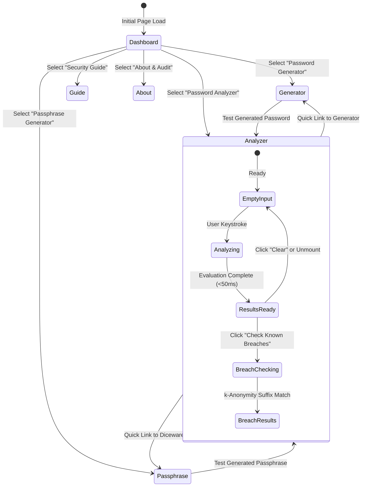

# Application Flow (APP_FLOW.md)
## PassGuard — User Journeys & State Transitions

---

## 1. Top-Level Application State Machine

PassGuard routes views via an ephemeral client-side state machine without triggering browser URL history leakage of sensitive states:

---

## 2. Key User Journeys

### 2.1 Journey 1: Evaluating a Personal Password for Vulnerabilities
1. User lands on **Dashboard** or clicks **Password Analyzer**.
2. User types or pastes their target password into the `PasswordInput` field.
3. As keystrokes occur, `analyzePassword()` calculates:
   - Visual strength tier (0 to 4) on an accessible multi-segment progress bar.
   - Dual-entropy comparison (Effective bits vs Theoretical bits).
   - Character composition breakdown (length, upper, lower, digits, symbols, uniqueness).
   - Pattern detections (repeated characters, spatial walks, l33t speak, dictionary words).
   - Simulated cracking effort across 4 standardized attacker scenarios.
4. User clicks **Check Known Breaches**:
   - Web Crypto calculates SHA-1.
   - 5-char prefix is sent to HIBP; suffix matched locally in memory.
   - Exact breach count or "clean" badge displayed alongside cryptographic verification dropdown.
5. User clicks **Clear**: All inputs and derived results are instantly wiped from client memory.

### 2.2 Journey 2: Generating a Cryptographically Secure Password
1. User navigates to **Password Generator**.
2. User selects length (e.g., 24 characters) and checks desired character sets.
3. User toggles "Exclude Ambiguous" (`0, O, 1, l, I`) to prevent reading errors.
4. User selects batch quantity (e.g., 5 passwords).
5. Generator leverages Web Crypto API CSPRNG with rejection sampling and Fisher-Yates shuffling to ensure at least one character from every selected class is present.
6. User clicks **Copy Password**:
   - Text is written to system clipboard.
   - Button animates to "Copied!" for 2 seconds.
   - User pastes into their local password manager.

### 2.3 Journey 3: Generating a Human-Memorable Diceware Passphrase
1. User navigates to **Passphrase Generator**.
2. User selects 4 to 6 words using the slider.
3. User chooses separator (`-`, `.`, `_`, space, or random) and capitalization (`TitleCase`).
4. Generator draws words randomly from the curated EFF Diceware wordlist using `crypto.getRandomValues`.
5. UI displays the complete passphrase alongside individual word pill tokens, entropy bits (e.g., 65.4 bits), and estimated cracking effort ("Centuries+").
6. User copies the passphrase for use as a master password or full-disk encryption key.

### 2.4 Journey 4: Exploring the Security Guide
1. User navigates to **Security Guide**.
2. User filters topics by category ("All", "Attack Vectors", "Defenses & Hygiene", "MFA & Passkeys") or types in search bar.
3. User expands accordion items to read beginner-friendly yet technically rigorous breakdowns of Hashcat rules, credential stuffing pipelines, password spraying, and FIDO2 passkeys.
