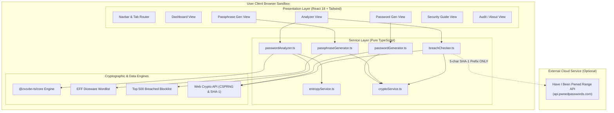
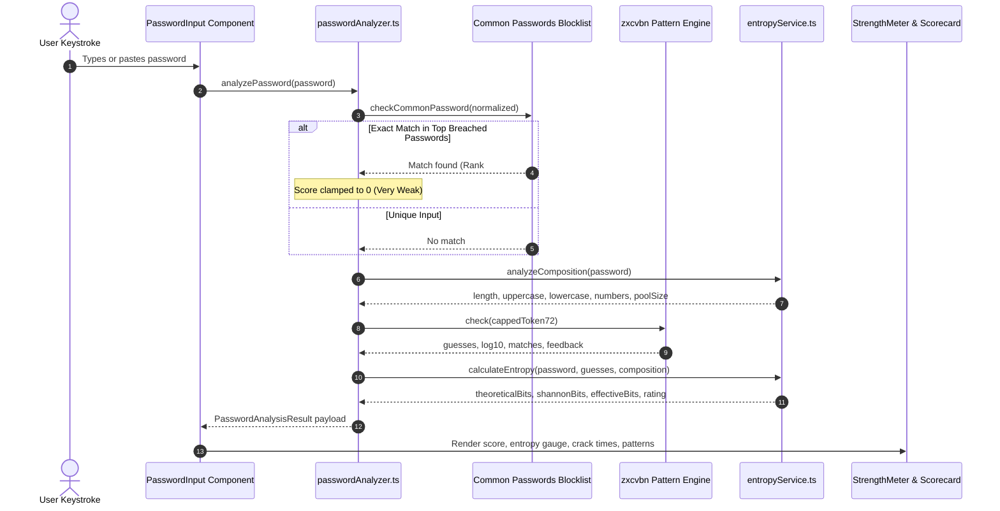
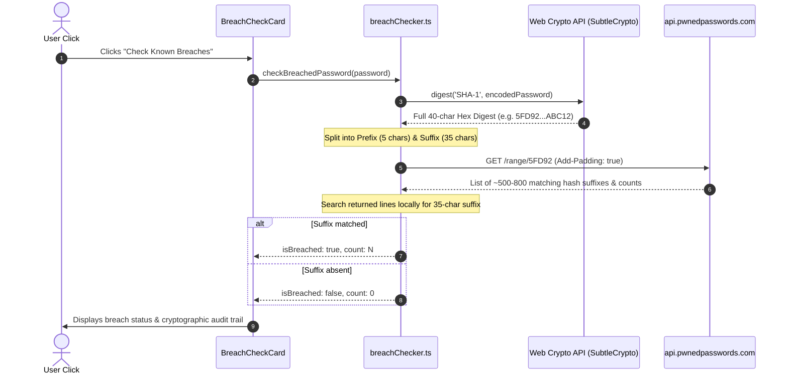

# Architecture Document

## PassGuard — Technical Architecture & Component Flow

---

## 1. Architectural Principles

PassGuard is architected according to four core tenets:

1. **Client-Side Sovereignty:** All computation occurs in the browser. The user's device is the single execution boundary.
2. **Zero-Knowledge Privacy:** Secrets entered or generated never traverse an outbound socket or persist to local web storage.
3. **Defense-in-Depth Cryptography:** We combine multiple evaluation techniques (Shannon entropy, Hartley pool bounds, zxcvbn graph search, common password hash sets, and k-Anonymity API queries).
4. **Resilient Performance:** We decouple expensive matching loops from rendering using functional decomposition and cap graph-search token windows at 72–256 characters to avoid Algorithmic Complexity / ReDoS delays.

---

## 2. High-Level System Architecture

---

## 3. Detailed Data Flow Architecture

### 3.1 Password Strength Analysis Flow

### 3.2 k-Anonymity Breach Verification Flow

---

## 4. Subsystem Specifications

### 4.1 Cryptographic Randomness Subsystem (`cryptoService.ts`)

- Utilizes `window.crypto.getRandomValues(Uint32Array)`.
- Eliminates modulo bias via rejection sampling loop against the highest multiple of $N$ below $2^{32}$.
- Implements in-place Fisher-Yates array shuffling with unbiased random index selection.

### 4.2 Entropy Estimation Subsystem (`entropyService.ts`)

- **Hartley Bound:** Computes $L \log_2(R)$ to represent maximum theoretical search space.
- **Shannon Entropy:** Computes character frequency distribution to detect character repetition deficits.
- **Effective Entropy:** Computes $\log_2(\text{guesses})$ based on zxcvbn's graph model of shortest attack paths.

### 4.3 Breached Password Subsystem (`breachChecker.ts`)

- Implements Cloudflare-backed Have I Been Pwned Range API with `Add-Padding: true` header to prevent network-level side-channel packet size inspection.
- Enforces a 6,000ms network timeout with `AbortController` and graceful offline fallback.
