# CI/CD Pipeline & GitHub Actions Guide (CI_CD_GUIDE.md)
## PassGuard — Automated DevSecOps, Continuous Integration & Deployment

---

## 1. Overview & Pipeline Philosophy

PassGuard incorporates an automated **DevSecOps CI/CD pipeline** via GitHub Actions. Every commit or pull request to the `main` branch automatically triggers static analysis, automated unit tests, component tests, end-to-end browser tests, production compilation, and dependency vulnerability auditing.

```mermaid
flowchart LR
    GitPush["git push / PR"] --> Checkout["1. Checkout & Node 20 Setup"]
    Checkout --> DepInstall["2. npm ci (Clean Install)"]
    DepInstall --> TypeCheck["3. TypeScript Typecheck (tsc --noEmit)"]
    TypeCheck --> UnitTests["4. Vitest Unit & Privacy Tests (48 tests)"]
    UnitTests --> ProdBuild["5. Production Build (vite build)"]
    ProdBuild --> Playwright["6. Playwright E2E Tests (Chromium)"]
    Playwright --> SecAudit["7. Security Audit (npm audit --omit=dev)"]
    SecAudit --> DeployPages["8. Deploy to GitHub Pages (Static Hosting)"]
```



---

## 2. Pipeline Configuration (`.github/workflows/ci.yml`)

The workflow file is located at `.github/workflows/ci.yml` and consists of two sequential jobs:

### 2.1 Job 1: `test-and-build`
- **Runner:** `ubuntu-latest`
- **Node.js:** Version 20.x with npm dependency caching.
- **Tasks Executed:**
  1. `npm ci`: Deterministic, clean dependency installation from `package-lock.json`.
  2. `npx tsc --noEmit`: Strict static type-checking verifying zero compiler errors.
  3. `npm test`: Executes all 48 Vitest test suites (entropy calculations, rejection sampling, $k$-anonymity, zero persistence).
  4. `npm run build`: Compiles optimized, minified static assets to `dist/`.
  5. `npx playwright test --project=chromium`: Runs headful/headless browser automation testing full user flows.
  6. `npm audit --omit=dev`: Verifies 0 vulnerabilities in runtime dependencies.
  7. `actions/upload-pages-artifact@v3`: Packages `dist/` for GitHub Pages deployment.

### 2.2 Job 2: `deploy-pages`
- Triggers on successful merge to `main`.
- Deploys static build artifact directly to GitHub Pages using OpenID Connect (OIDC) tokens without exposing repository secrets.

---

## 3. Running Playwright E2E Tests Locally

To execute Playwright browser automation tests on your local machine:

```bash
cd 02-PassGuard-Password-Analyzer

# Install browser binaries (first time only)
npx playwright install chromium

# Run all E2E specs
npm run test:e2e

# Run with interactive UI mode
npx playwright test --ui

# View generated test report
npx playwright show-report
```

---

## 4. Enabling GitHub Pages in Your Repository

Once the repository is pushed to GitHub:
1. Navigate to your repository: `https://github.com/<your-username>/02-PassGuard-Password-Analyzer`.
2. Click **Settings** &rarr; **Pages** (under Code and automation).
3. Under **Build and deployment** &rarr; **Source**, select **GitHub Actions**.
4. The pipeline will automatically build and publish PassGuard live on the web!
