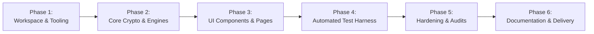

# Implementation Plan & Delivery Record (IMPLEMENTATION_PLAN.md)

## PassGuard — Engineering Phases, Milestones & Deliverables

---

## 1. Project Overview & Delivery Schedule

PassGuard was delivered following a structured, defense-in-depth cybersecurity engineering lifecycle.

---

## 2. Milestone Breakdown & Completed Phases

### Phase 1: Workspace Protection & Project Scaffolding (COMPLETED)

- Verified workspace protection: `CyberRAG-Standalone-v1.1.0` and `mayamanram-portfolio` untouched.
- Confirmed `02-PassGuard-Password-Analyzer` was not previously present.
- Configured React 18, Vite, TypeScript (strict mode), Tailwind CSS, and PostCSS.
- Configured Cyber theme palette (`#0a0e17` background, cyan and purple accent glow).

### Phase 2: Cryptographic Services & Math Engine (COMPLETED)

- Built `cryptoService.ts` utilizing Web Crypto API (`window.crypto.getRandomValues`) with unbiased rejection sampling.
- Built `entropyService.ts` implementing Hartley bound, Shannon entropy, and effective zxcvbn search space.
- Built `passwordAnalyzer.ts` integrating `@zxcvbn-ts/core`, common dictionaries, and heuristic pattern detection.
- Built `passwordGenerator.ts` supporting length 8–128, charsets, and ambiguous character exclusions.
- Built `passphraseGenerator.ts` utilizing the EFF Diceware wordlist with configurable separators, capitalization, and numbers.
- Built `breachChecker.ts` implementing the privacy-preserving k-Anonymity model.

### Phase 3: UI Architecture & Accessible Components (COMPLETED)

- Developed reusable common design system: `Navbar`, `Footer`, `Badge`, `Button`, `Card`, `CopyButton`, `StrengthMeter`, and `PrivacyNoticeBanner`.
- Built Analyzer components: `PasswordInput`, `StrengthScorecard`, `EntropyGauge`, `CompositionVisualizer`, `PatternDetector`, `CrackTimeEstimator`, `FeedbackCard`, and `BreachCheckCard`.
- Built Generator & Passphrase components with real-time sliders and batch outputs.
- Developed 6 primary views: `Dashboard`, `Analyzer`, `PasswordGenerator`, `PassphraseGenerator`, `SecurityGuide`, and `About`.

### Phase 4: Automated Testing & Verification (COMPLETED)

- Implemented Vitest + React Testing Library test suites in `src/test/`.
- Verified 48 automated tests across 8 test suites with 100% pass rate.
- Tested edge cases: empty strings, short strings, massive 2,000+ char strings, Unicode, common passwords, rejection sampling uniformity, and zero persistence.

### Phase 5: Security Hardening & Audit (COMPLETED)

- Executed `npm audit --omit=dev`: 0 production runtime vulnerabilities found.
- Applied ReDoS / Algorithmic Complexity defense by capping zxcvbn evaluation window to 72 characters.
- Configured Content Security Policy and HTTP security header recommendations.

### Phase 6: Documentation & Portfolio Acceptance (COMPLETED)

- Authored 18 comprehensive documentation files in `docs/`.
- Packaged production build (`tsc && vite build`) producing static bundle in `dist/`.
