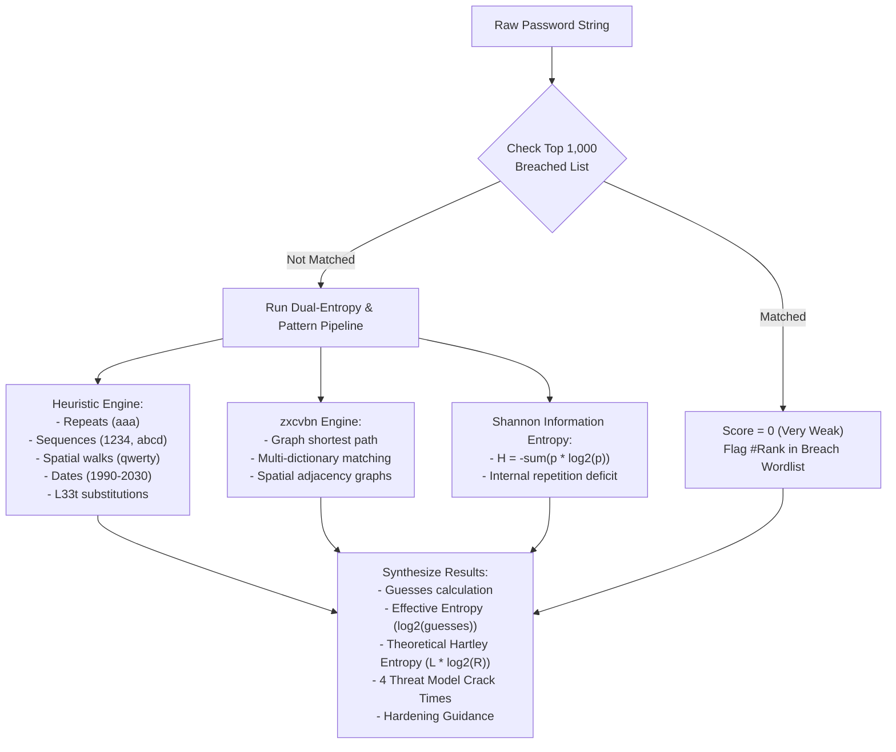

# Password Analysis Methodology (PASSWORD_ANALYSIS_METHODOLOGY.md)

## PassGuard — Pattern Matching, Entropy Models & Threat Estimation

---

## 1. Why Traditional Password Scoring Fails

Traditional password meters rely on simplistic rules:

1. "Must be 8 characters long"
2. "Must contain 1 uppercase, 1 lowercase, 1 number, and 1 special symbol"

This approach creates an illusion of security while actually training users to create highly predictable passwords like `Spring2024!` or `P@ssw0rd123!`. Both satisfy all four rules, yet automated password crackers like Hashcat test them within milliseconds because:

- Attackers don't guess uniformly across all characters.
- Attackers prioritize English dictionary roots, seasonal words, common numbers, and standard l33t replacement rules.

PassGuard replaces simplistic scoring with **pattern recognition and search-space modeling**.

---

## 2. Multi-Tiered Analysis Methodology

---

## 3. Mathematical Entropy Models Compared

### 3.1 Theoretical Hartley Entropy ($E_{\text{theoretical}}$)

$$E_{\text{theoretical}} = L \times \log_2(R)$$

- Measures the total combinatorial capacity if every character was chosen uniformly at random from pool size $R$.
- For example, `P@ssw0rd2024!` has length $L = 13$, pool $R = 95$ (upper, lower, digits, symbols):
  $$E_{\text{theoretical}} = 13 \times \log_2(95) \approx 85.4 \text{ bits}$$
- **The Pitfall:** An attacker guessing `P@ssw0rd2024!` does not test $2^{85.4}$ combinations.

### 3.2 Shannon Information Entropy ($H$)

$$H(X) = -\sum_{i=1}^{n} p(x_i) \log_2 p(x_i), \quad E_{\text{shannon}} = L \times H(X)$$

- Quantifies internal character diversity. Penalizes repeated characters (`aaaa` has $H = 0$ bits).

### 3.3 Effective Realistic Entropy ($E_{\text{effective}}$)

$$E_{\text{effective}} = \log_2(\text{guesses})$$

- Calculated using zxcvbn's minimum guess estimate.
- For `P@ssw0rd2024!`, zxcvbn recognizes the base word `password` (guesses $\approx 3$), l33t substitution rules ($\approx 3$), and the year `2024` with `!` ($\approx 100$).
- Total guesses $\approx 10^5$, giving an effective entropy of:
  $$E_{\text{effective}} = \log_2(100,000) \approx 16.6 \text{ bits}$$
- **The Entropy Deficit:** $85.4 - 16.6 = 68.8$ bits lost to predictability!

---

## 4. Threat Model Cracking Speeds & Assumptions

PassGuard evaluates passwords across four realistic threat models:

| Scenario              | Rate / Speed                   | Hardware & Operational Context                                                                                         | Defense Mitigation                                                    |
| --------------------- | ------------------------------ | ---------------------------------------------------------------------------------------------------------------------- | --------------------------------------------------------------------- |
| **Online Throttled**  | 100 guesses / hour (~0.0277/s) | Cloud API with strict lockout, IP rate-limiting, and CAPTCHA after 5 failed tries.                                     | Account lockout, risk-based MFA.                                      |
| **Online Standard**   | 10 guesses / sec               | Unthrottled web portal or legacy API without rate limits.                                                              | Web Application Firewall (WAF), rate limits.                          |
| **Offline Slow Hash** | 10,000 guesses / sec           | Stolen database hashed with memory-hard KDFs (bcrypt cost $\ge 12$, Argon2id). Dedicated 8x RTX 4090 rig.              | Upgrade legacy hashes to Argon2id / bcrypt.                           |
| **Offline Fast Hash** | 100,000,000,000 guesses / sec  | Stolen database hashed with fast unshaded algorithms (MD5, NTLM, raw SHA-256). Enterprise GPU cluster running Hashcat. | Never store unsalted fast hashes; salting + memory-hard KDF required. |
