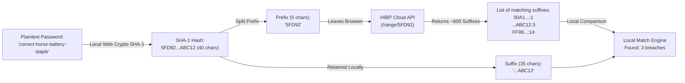

# Privacy Design & k-Anonymity Architecture (PRIVACY_DESIGN.md)

## PassGuard — Zero-Knowledge Privacy Architecture

---

## 1. The Zero-Knowledge Privacy Guarantee

PassGuard operates under a strict **Zero-Knowledge Privacy Guarantee**:

> "Your password is analyzed locally in your browser. PassGuard does not store, log, or transmit the password you enter."

Every evaluation and generation feature executes entirely in the client's volatile memory.

---

## 2. Mathematical Foundation of k-Anonymity

When verifying whether a password has appeared in historical data breaches, transmitting the password (or even a full cryptographic hash of it) would violate confidentiality and create a central point of compromise.

PassGuard uses the **k-Anonymity model** pioneered by L. Sweeney and implemented by the Have I Been Pwned Pwned Passwords API.

### 2.1 The Mathematical Principle

A data release provides $k$-anonymity if the information for each person contained in the release cannot be distinguished from at least $k-1$ other individuals whose information also appears in the release.

### 2.2 Proof of Privacy

1. The SHA-1 space has $16^{40} \approx 1.46 \times 10^{48}$ possible digests.
2. A 5-character hexadecimal prefix represents $16^5 = 1,048,576$ buckets.
3. In a database of $> 800$ million compromised credentials:
   $$\text{Average entries per prefix} \approx \frac{800,000,000}{1,048,576} \approx 762 \text{ distinct passwords}$$
4. When the API or an eavesdropping ISP observes the query `GET /range/5FD92`, they learn only that the user is inquiring about _one_ of roughly 762 passwords sharing that prefix. It is mathematically impossible to deduce which one.
5. The remaining 35 characters ($16^{35} \approx 2.4 \times 10^{42}$ possibilities) **never leave browser memory**.

---

## 3. Storage Boundary Audit

PassGuard enforces zero persistence across all client storage mechanisms:

- **`localStorage`:** 0 items stored. (Verified via automated test `privacy.test.ts`).
- **`sessionStorage`:** 0 items stored. (Verified via automated test `privacy.test.ts`).
- **`document.cookie`:** 0 cookies created.
- **IndexedDB:** No database opened or queried.
- **URL Parameters:** 0 secrets reflected in `location.search` or `location.hash`.
- **Browser History:** No state saved into `history.pushState` with password data.

---

## 4. Lifecycle Memory Scrubbing

React states holding password data (`password`, `quickInput`, `passwords`, `passphrases`) are localized to individual component lifecycles.

- When the user clicks **Clear**, state is immediately reassigned to `""` or `[]`.
- When the user navigates away or unmounts the tab, cleanup functions (`useEffect(() => () => setPassword(''), [])`) ensure the garbage collector can reclaim memory allocations.
