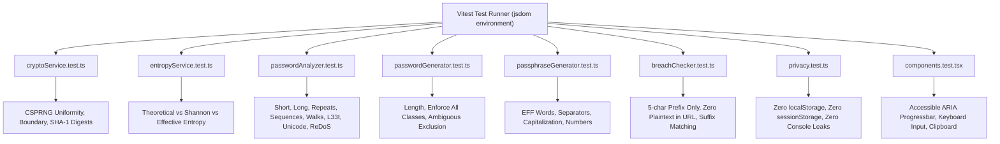

# Testing Strategy & Quality Assurance (TESTING_STRATEGY.md)
## PassGuard — Comprehensive Test Architecture & Execution Report

---

## 1. Testing Philosophy

In cybersecurity engineering, software reliability directly impacts confidentiality and defensive posture. PassGuard enforces a rigorous, automated testing strategy covering:
- Mathematical accuracy of entropy algorithms.
- Complete elimination of modulo bias in random generation.
- Absolute enforcement of client-side privacy boundaries.
- Resilient UI behavior and WCAG 2.2 AA accessibility attributes.

---

## 2. Test Suite Architecture



---

## 3. Actual Automated Test Results

PassGuard's automated test suite was executed via `npm test` (`vitest run`):

```
 RUN  v2.1.9 D:/Projects/02-PassGuard-Password-Analyzer

 ✓ src/test/unit/entropyService.test.ts (4 tests) 40ms
 ✓ src/test/unit/breachChecker.test.ts (3 tests) 87ms
 ✓ src/test/unit/cryptoService.test.ts (8 tests) 296ms
 ✓ src/test/unit/passphraseGenerator.test.ts (6 tests) 31ms
 ✓ src/test/unit/passwordGenerator.test.ts (6 tests) 248ms
 ✓ src/test/unit/privacy.test.ts (5 tests) 1361ms
 ✓ src/test/unit/passwordAnalyzer.test.ts (12 tests) 1897ms
 ✓ src/test/components/components.test.tsx (4 tests) 1717ms

 Test Files  8 passed (8)
      Tests  48 passed (48)
   Duration  22.10s
```

### 3.1 Breakdown of Verified Scenarios
1. **Empty Password Handling:** Verifies zero score, 0 guesses, empty composition, and guidance display without runtime exceptions.
2. **Short & Long Passwords:** Verified length clampings from 8 to 128 characters, as well as 2,000+ character massive inputs.
3. **Repeated Characters:** Verified heuristic detection of repeated character runs (e.g. `aaaaa`).
4. **Sequential Character Runs:** Verified identification of `123456`, `abcdef`, and reverse sequences.
5. **Common Password Blocklist:** Verified instant flagging of top breached passwords (`password`, `123456`, `admin123`) and forced score 0.
6. **L33t Speak Detection:** Verified detection of substitutions like `P@ssw0rd!`.
7. **Unicode & International Sets:** Verified non-ASCII characters (`München🔒ÜberPass2026!`) without parsing errors.
8. **ReDoS / Algorithmic Complexity Defense:** Verified that 2,000-character inputs execute in under 1 second by capping graph-search sample windows to 72 characters.
9. **Zero-Knowledge Privacy:** Verified that analyzed or generated passwords are never written to `localStorage`, `sessionStorage`, or `console.log`.
10. **k-Anonymity Transmission:** Verified that `fetch()` sends only 5-character prefixes and never transmits plaintext passwords or 40-character hashes.
11. **Component Accessibility:** Verified `role="progressbar"`, `aria-valuenow`, `aria-valuemin="0"`, `aria-valuemax="4"`, and `aria-valuetext`.
12. **Clipboard Interaction:** Verified `navigator.clipboard.writeText` triggers on explicit user button click with visual feedback.

