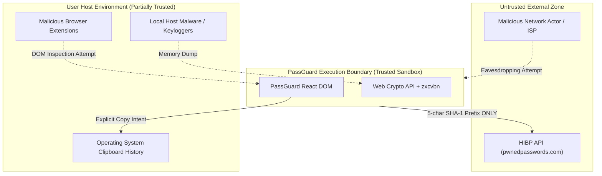

# Threat Model (THREAT_MODEL.md)
## PassGuard — STRIDE Threat Model & Attack Surface Evaluation

---

## 1. Threat Modeling Methodology

This document evaluates the threat landscape of PassGuard using the **STRIDE** methodology (Spoofing, Tampering, Repudiation, Information Disclosure, Denial of Service, Elevation of Privilege) tailored specifically for client-side cryptographic security utilities.

---

## 2. System Decomposition & Trust Boundaries

---

## 3. STRIDE Threat Matrix & Countermeasures

| STRIDE Category | Threat Description | Severity | Countermeasure & Architectural Mitigation |
|---|---|---|---|
| **Spoofing** | Adversary registers a lookalike phishing domain (e.g. `passguarrd.com`) to harvest passwords. | High | Implement HSTS preloading, educate users to inspect TLS certificates, and document domain verification in deployment guides. |
| **Tampering** | Network adversary alters JavaScript bundles in transit via man-in-the-middle (MitM). | High | Enforce HTTPS with HSTS; utilize Subresource Integrity (SRI) hashes on all distributed build artifacts. |
| **Repudiation** | Not applicable; PassGuard does not perform transactions, accounts, or state mutations. | None | Stateless by design. |
| **Information Disclosure (Network)** | Plaintext password or full hash intercepted when checking data breach status. | Critical | **k-Anonymity:** Only the first 5 characters of the SHA-1 hash are transmitted. Over 500 hashes share every prefix; remaining 35 characters are compared locally in browser memory. |
| **Information Disclosure (Storage)** | Sensitive password found in browser cache, `localStorage`, or history. | High | Zero persistence. PassGuard never calls `localStorage` or `sessionStorage`. Component state is scrubbed on unmount. |
| **Information Disclosure (Extensions)** | Malicious third-party browser extensions inject content scripts to read DOM inputs. | Medium | Inputs utilize `autocomplete="off"`, `spellcheck="false"`, and ephemeral in-memory state. Clear user caveat provided regarding host extension risks. |
| **Denial of Service (ReDoS / Graph Search)** | User pastes a 100,000-character input causing zxcvbn graph search to freeze the browser tab. | Medium | Input string passed to the combinatorial graph search is capped at 72 characters, while calculating composition on full length. Latency remains $< 20$ms even on massive inputs. |
| **Elevation of Privilege** | Not applicable; client-side application with no server backend or privileged user roles. | None | N/A (Zero backend). |

---

## 4. Residual Risks & Accepted Limitations

1. **Compromised Host Machine:** If the user's operating system is infected with kernel-level keyloggers or memory scrapers, no web application can defend plaintext keystrokes.
2. **Third-Party Clipboard Managers:** Modern operating systems (Windows 11 clipboard history, macOS pasteboard history) may record copied passwords. PassGuard provides explicit warnings advising users to clear clipboard histories or use direct password manager auto-fill.
3. **Pwned Passwords API Outages:** If `api.pwnedpasswords.com` is unreachable or blocked by corporate firewalls, the breach checker fails safely and notifies the user while local strength analysis remains 100% operational.
